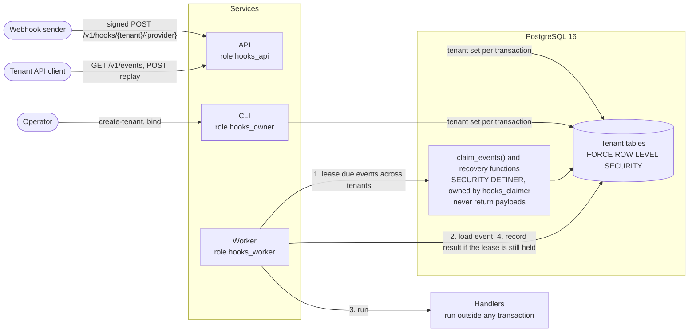

# tenant-hooks

[](https://github.com/DaniilK19/tenant-hooks/actions/workflows/ci.yml)

A multi-tenant webhook gateway built on PostgreSQL, with no message broker. It verifies
signed webhooks, stores each event exactly once, and runs handlers with retries, a
dead-letter queue and replay.

Tenant isolation is enforced by the database. Every table has forced row-level security
and the services connect as roles that cannot bypass it, so a query that forgets its
tenant filter still returns only the current tenant's rows.

## Architecture



1. **Intake.** The URL names the tenant, but only as a claim. The API sets that tenant on
   the transaction, loads its secrets under RLS and verifies the HMAC. The delivery record
   and the event commit together.
2. **Claim.** A worker leases due events with `FOR UPDATE SKIP LOCKED`. Claiming, lease
   recovery and purging old delivery ids are the only cross-tenant paths in the system.
   Each is a small `SECURITY DEFINER` function that returns ids or counts, never payloads.
3. **Process.** The worker loads the event as that tenant and runs the handler with no
   transaction open. The result is written only if its lease token still matches.
4. **Failure.** Retries back off with full jitter. An event that runs out of attempts is
   dead-lettered, and the tenant can replay it through the API.

Intake is exactly-once. Handlers run at least once, and receive the event id as an
idempotency key.

## Run it

You need Docker, bash, curl and openssl. On Windows, use Git Bash or WSL. Every default
in `docker-compose.yml` is a fake value for local use.

Start the stack and create a tenant:

```bash
docker compose up -d --build --wait

# Sets TENANT_ID, SIGNING_SECRET and API_KEY. The credentials are only shown this once.
eval "$(docker compose run --rm -T admin create-tenant 'Acme Inc' acme)"
docker compose run --rm -T admin bind "$TENANT_ID" acme order.created log_event
```

Define two helpers, one that signs and sends a webhook and one that lists events:

```bash
# send <delivery id> <JSON body>
send() {
  local timestamp signature
  timestamp=$(date +%s)
  signature=$(printf '%s.%s.%s' "$timestamp" "$1" "$2" \
    | openssl dgst -sha256 -hmac "$SIGNING_SECRET" -r | cut -d' ' -f1)
  curl -s -w ' HTTP %{http_code}\n' "http://localhost:8000/v1/hooks/$TENANT_ID/acme" \
    -H "X-Hooks-Timestamp: $timestamp" \
    -H "X-Hooks-Delivery-Id: $1" \
    -H "X-Hooks-Signature: v1=$signature" \
    --data-binary "$2"
}

# events [query string]
events() {
  curl -s -w '\n' -H "Authorization: Bearer $API_KEY" "http://localhost:8000/v1/events${1:-}"
}
```

Deliver an event, then repeat it in both of the ways a sender can:

```bash
ORDER='{"id":"evt_1","type":"order.created","data":{"total":42}}'

send dlv_1 "$ORDER"   # HTTP 202, accepted
send dlv_1 "$ORDER"   # HTTP 409, the same delivery again is a replay
send dlv_2 "$ORDER"   # HTTP 200, a new delivery of a known event is a duplicate

sleep 3
events                                        # one event, status "succeeded"
docker compose logs worker | grep handled     # the handler ran once
```

Check that a bad signature is refused and that another tenant sees nothing:

```bash
SIGNING_SECRET=wrong send dlv_3 "$ORDER"      # HTTP 401

OTHER_KEY=$(docker compose run --rm -T admin create-tenant 'Other Inc' acme \
  | sed -n 's/^API_KEY=//p')
API_KEY=$OTHER_KEY events                     # []
```

Send an event whose handler has not been deployed. A missing handler fails like any
other, so the event retries with backoff and is dead-lettered, which takes up to about
75 seconds. Binding a real handler and replaying then completes it:

```bash
docker compose run --rm -T admin bind "$TENANT_ID" acme order.refunded not_deployed_yet
REFUND=$(send dlv_4 '{"id":"evt_2","type":"order.refunded"}')
EVENT_ID=$(echo "$REFUND" | sed -E 's/.*"event_id":"([^"]+)".*/\1/')

until events '?status=dead_lettered' | grep -q evt_2; do sleep 3; done
events '?status=dead_lettered'                # attempt_count 5, last_error UnknownHandlerError

docker compose run --rm -T admin bind "$TENANT_ID" acme order.refunded log_event
curl -s -w ' HTTP %{http_code}\n' -X POST -H "Authorization: Bearer $API_KEY" \
  "http://localhost:8000/v1/events/$EVENT_ID/replay"   # HTTP 202

sleep 3
events                                        # evt_2 is "succeeded" with replay_count 1
```

Remove the containers and the database:

```bash
docker compose down -v
```

## API

| Method | Path | Authentication | Result |
|---|---|---|---|
| `POST` | `/v1/hooks/{tenant_id}/{provider}` | HMAC signature | `202` accepted, `200` duplicate, `409` replay, `401` rejected, `400` bad body, `413` too large |
| `GET` | `/v1/events?status=&limit=` | API key | The caller's events, newest first |
| `POST` | `/v1/events/{event_id}/replay` | API key | `202` requeued, `409` not dead-lettered, `404` not found |
| `GET` | `/healthz` | None | Database connectivity |

A webhook carries three headers. `X-Hooks-Signature` is `v1=` followed by the hex
HMAC-SHA256 of `{timestamp}.{delivery_id}.{raw body}`, with the other two values taken
from `X-Hooks-Timestamp` and `X-Hooks-Delivery-Id`. The body must be JSON with string
`id` and `type` fields. API keys are sent as `Authorization: Bearer <key>`.

## Tests

The suite needs Docker. It starts a real PostgreSQL 16 with the same roles and migrations
that compose uses, because RLS cannot be tested against a mock.

```bash
uv sync
uv run pytest
uv run ruff check . && uv run ruff format --check . && uv run mypy
```

| Suite | What it proves |
|---|---|
| `tests/isolation` | A query with no tenant filter sees one tenant only, every table has forced RLS, and no service role can bypass it. Pooled connections do not carry a tenant over, and a negative control shows that session-level `SET` would. |
| `tests/intake` | Forged, stale, tampered and oversized requests are rejected. The same event sent 20 times concurrently is stored once. |
| `tests/processing` | Competing workers never process an event twice. A worker killed mid-handler is recovered, a zombie's late result is discarded, and a tenant cannot see or replay another tenant's events. |
| `tests/cli` | A tenant created by the CLI can deliver webhooks and read its events, and its credentials are not stored in the clear. |

## Layout

```text
src/tenant_hooks/
  api/        HTTP routes for intake, events and replay
  worker/     Claim, lease, retry and dead-letter loop
  handlers/   Handler registry and the demo handler
  security/   Signatures, API keys and encryption at rest
  cli.py      Operator commands that create tenants and bindings
  db.py       The only place that sets the current tenant
migrations/   Schema, RLS policies, grants and claim functions
docker/       Image and database role setup
```

## Design and limits

[DESIGN.md](DESIGN.md) records each decision and why it was made, including the options
that were rejected. It also lists the [known limitations](DESIGN.md#known-limitations),
for example that handlers have no lease heartbeat and that claiming has no per-tenant
fairness.
